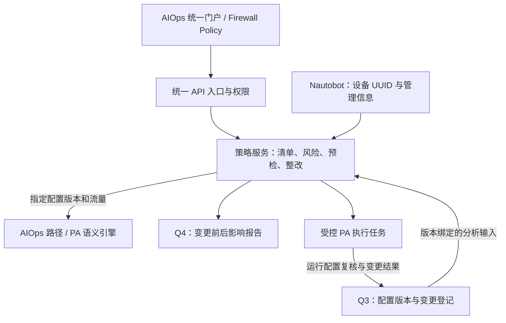

# Firewall Policy Tools 集成可行性评估

评估日期：2026-11-02。结论：可行，推荐独立策略服务接入 AIOps 统一门户；先接只读策略管理和风险分析，再接 Q4 变更推演，最后开放受控设备执行。本次仅评估，未部署服务、修改防火墙或启动发现扫描。

## 核查范围与证据

- 实际访问 `http://127.0.0.1:8080/`，检查 Access Rules、Risk Findings、PAN-OS Online、Change Requests 页面，无 JavaScript 页面异常；浏览检查拦截所有非 GET 请求。
- 当前页面统计为 4 条策略、0 条 NAT、8 个对象、8 项风险发现。该样本不足以证明所有厂商和 NAT 场景正确。
- 本地仓库 `/Users/owen.xie/Documents/ChatGPT/FireWall Policy Manager/FireWall-Policy-tools` 的 HEAD 与 GitHub `boxie283555/FireWall-Policy-tools` main 一致：`dc81f4ab4293ccb6545c037b16fe54fe1b983d7c`。
- 阅读模型、解析器、分析器、存储、预检、在线编辑、路径及前端路由代码；运行 `test_panos_online.py`，19 项模拟测试通过，没有连接设备。
- 用独立合成规则复现跨设备重复/冲突/遮蔽误报，以及同一 PA 原生 UUID 规则因前方插入规则而改变内部 ID。
- 这不是全面代码审计，也不是实际提交、全厂商解析或大规模性能验收。

## 能力分工

| 能力 | 现有基础 | 集成建议 |
| --- | --- | --- |
| 设备身份与管理信息 | AIOps 使用 Nautobot；策略工具有自己的设备表 | Nautobot UUID 为统一身份；策略工具保留映射和离线导入身份，不成为第二套设备真相源 |
| 策略/NAT/对象清单 | 策略工具支持 ASA、PA、Fortinet、Huawei 配置解析与检索 | 复用界面和解析适配器；每厂商标注已支持/未验证字段 |
| 风险分析与整改 | 策略工具已有宽泛规则、重复、冲突、生命周期、整改计划、命令预览 | 修复作用域和对象语义后复用；风险发现附规则、版本、证据及限制 |
| 备份与历史 | Q3 已有持久版本、观察时间、结构化 diff、漂移及恢复审计 | 复用 Q3 版本作为策略分析输入；策略服务存派生索引和工单，不另建独立备份基线 |
| 网络拓扑与 A→B | 两边都有发现、拓扑及路径计算；AIOps 已有 VRF、流量状态和部分 PA NAT 语义 | AIOps 作为全网拓扑/路径入口；策略工具保留规则依赖图、矩阵，路径调用统一引擎 |
| PA 在线编辑 | 有只读会话、预览、候选版本校验、一次性计划、独立全设备 commit 和任务查询 | 最后接入；需绑定身份权限、设备范围、变更单、前后备份和验证 |
| 报告 | 策略工具已有 CSV 和风险汇总 | 增加 Q4 评审报告，关联流量、路径、配置版本和变更结果 |

## 推荐结构

两边同为 Python/FastAPI，API 接入成本较低。建议新服务放入内部容器网络，由统一入口提供 `/firewall/` 页面及 `/api/firewall/` 接口。现有 AIOps 已占用 8080，不能直接照策略工具当前 Compose 的 `8080:8080` 部署。独立服务也可隔离 Netmiko 4.4.0/4.6.0 等依赖差异及耗时分析任务。

当前前端大量硬编码 `/api/...`、`/static/...`，部署在路径前缀下需要统一 URL base 和静态资源路由。页面改为支持中英文并沿用 AIOps 的设备筛选与深链接。原有策略 SQLite 可继续承载工单和派生索引；通过 API 交换数据，不跨服务直接写对方数据库。

## 接入前必须处理的差距

1. **稳定身份与作用域。** 当前 `PolicyRule` 主要以设备名、规则名和行号识别，缺少统一设备 UUID、VSYS/VDOM、rulebase、配置版本。`parser._rule_id()` 包含行号/原始文本；PA 原生规则 UUID 未成为稳定身份。应采用设备 UUID + 配置上下文 + 原生规则 ID，并把版本/顺序作为独立字段；无原生 ID 时需定义显式映射和重命名处理。
2. **风险误报和语义精度。** `analyzer._duplicate_findings/_conflict_findings/_shadow_findings` 未强制按设备和策略上下文隔离，合成测试已复现跨设备误报。`_field_covers` 主要做字符串集合包含，不能代表 CIDR、地址组、服务范围的完整包含关系；`_covers` 未包含用户匹配条件。需保留规则顺序、否定条件和未知状态，解析对象依赖后再评估。风险减少不能直接解释为业务无影响。
3. **配置来源与时效。** 离线导入、running、candidate 必须显式区分；每份分析携带 `device_id`、`snapshot_id`、digest、采集时间、来源、作用域与能力限制。Q3 的脱敏文件预览不是完整分析接口：服务端适配器应从受控原始备份/规范化证据生成仅含必要策略语义的输入，不通过浏览器传递设备凭据或整份秘密配置。
4. **统一路径结论。** 现有 AIOps 已实现部分确定性 PA NAT、首匹配不确定性与原生规则/会话核验；另一套引擎有独立能力边界。不能因界面集成就把两者视为等价。以同一 flow、VRF、入接口和版本调用统一评估服务，区分配置推演、设备查询、会话观察和实际转发验证；未支持的动态 NAT、Panorama 等明确返回未知。
5. **变更登记与执行闭环。** 策略工具的 approved/implemented 是手动状态，不等同于身份认证后的审批或设备执行成功。统一变更 ID，先登记设备、时间窗口、精确配置块，再取得基线备份；提交后确认 FIN/OK，重新获取 running 并备份，关联漂移及业务验证。旧漂移不因事后审批而追认为有主。
6. **在线执行边界。** 策略工具已有只读模式及候选指纹校验，但应用内会话锁无法排除其它管理员并发修改；当前 commit 是全设备提交，可能包含其它人的待提交内容。上线写操作前需纳入统一身份/角色、确认完整差异、设备锁或可用的并发控制、失败状态及人工核查流程。现有 AIOps 的 PA 集成为只读，p1-host 的 EOS 恢复能力不能当成 PA 回退能力。
7. **发现与负载。** 策略工具的种子/CIDR 发现不直接沿用为第二条自动采集链。首次集成以当前 Nautobot lab 清单为边界，复用既有证据。风险成对比较和全设备配置预览可能耗时，使用独立有界任务、按版本缓存和任务状态，不占用 AIOps 设备指标采集线程。

## 分步实施和验收

| 阶段 | 内容 | 验收重点 |
| --- | --- | --- |
| 1. 只读策略中心 | 修复模型作用域和稳定 ID；PA-171/PA-172 映射；策略/NAT/对象、风险、报告、中英文入口 | 同一版本结果可重复；不同 VSYS/设备不串数据；导入失败保留旧快照并显示时效；采集与 Dashboard 正常 |
| 2. Q4 影响推演 | 将候选修改应用到隔离模型，比较指定业务流量的前后规则/NAT/路径和受影响对象 | 指定测试流量可解释 allow→deny、路径/NAT 变化及未知原因；候选配置不覆盖运行证据 |
| 3. 受控 PA 变更 | 预登记、基线备份、预览、候选编辑、完整 commit 审查、任务结果、后备份和核验 | 先以 lab PA 试点；并发/超时/失败有明确状态；变更引用与漂移归属一致；回退方案单独验证 |
| 4. 多厂商扩展 | 按实际版本验证 ASA/FortiGate/Huawei；逐项声明导入、分析、推演、执行能力 | 解析支持不冒充在线编辑或真实转发支持；逐厂商验收 |

建议首先做阶段 1，再用一组明确的业务流量验证阶段 2。Q4 最终仍需实际评审采用报告，并复核实施结果；模块集成上线本身不等于 Q4 验收完成。

## 主要代码依据

策略工具：`app/models.py`、`app/parser.py`、`app/analyzer.py`、`app/precheck.py`、`app/storage.py`、`app/panos_online.py`、`app/network_flow.py`、`app/main.py`、`app/static/app.js`、`docker-compose.yml`。

AIOps：`agent/aiops_agent/panos_policy.py`、`panos_evidence.py`、`flow.py`、`config_history.py`，以及 `docs/pa-flow-analysis.md`、`docs/configuration-drift-q3.md`。
