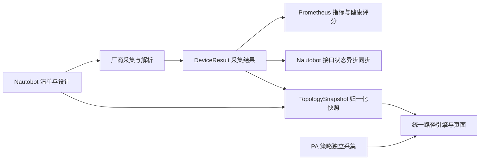

# 归一化模型 v1：设计摘要

目标：让采集、Nautobot 同步、指标、拓扑和路径查询共用同一套设备语义，避免页面各自解析厂商命令。**“模型 v1”是设计版本；当前拓扑 JSON 的 `schema_version` 是 `1.1`，流量状态版本是 `1.0`。**

| 层级 | 主要对象 | 职责 |
|---|---|---|
| 清单与设计 | `Device`、Nautobot cable | 设备 UUID、站点、角色、管理地址、平台和连接参数；已登记布线 |
| 采集结果 | `DeviceResult` | 本轮设备状态、接口、ARP/FDB、LLDP、邻居、路由、硬件与资源；保存采集时间及逐数据集成功状态 |
| 归一化模型 | `TopologySnapshot` | 设备、接口、VRF、端点、链路、路由之间的稳定引用；来源、时效及确认状态 |
| 流量推演 | `FlowState`、PA policy evidence | 每条分支独立的五元组、应用假设、NAT 前后状态、命中规则与证据等级 |

`DeviceResult` 是内部采集传输对象，不是完整的持久化模型契约；其原始输出供解析复用，不作为公共 API 的稳定字段。`model.py` 定义标识和名称规范，`topology.py` 生成版本化快照，`path_query.py` 负责页面/API 共用计算。

**身份规则：**设备优先使用 Nautobot UUID；接口 ID 由设备 UUID＋规范接口名派生；VRF ID 由设备 UUID＋VRF 名派生。端点附带设备、VRF、接口、VLAN 和作用域，相同 IP/MAC 不跨作用域合并。接口保存物理口、聚合口、子接口的父子关系，并保留原名/别名。设备改名不改变 Nautobot UUID；接口实际改名不被猜测成同一端口。

**证据规则：**未知值保留 `null`；失败与成功空结果不同。失败保留原成功时间并标记过期，不能刷新旧证据的时间。默认 TTL 600 秒。物理线缆须由 LLDP 双端端口或 Nautobot 已登记线缆确认；ARP/MAC 关联只是候选。设备采集成功不等于所有数据集成功，更不等于业务可达。

**真相源边界：**Nautobot 管理清单身份与设计；运行接口状态、路由、会话等事实来自设备采集。Nautobot 接口同步是异步结果写回，不覆盖这个来源区别。默认不把 Nautobot 故障静默切成 YAML；有效来源可查 `/api/inventory/status`。当前活动清单在 Agent 启动时读取，修改清单后需重启 Agent。

**兼容性：**保留原有 API 字段和名称查询；新增字段向后兼容；旧名称布局仍可读取。默认路径分析为 `routing`；显式 `analysis=flow` 才评估支持的 PA 策略/NAT。遇到歧义、未知能力或过期证据返回明确状态，不能补造完整路径。

实现细节、接口示例与历史验收见 [归一化快照说明](normalized-model-v1.md)；流量模型范围见 [PA 流量分析](pa-flow-analysis.md)；评分方法见 [网络健康评分](network-health-score.md)。
